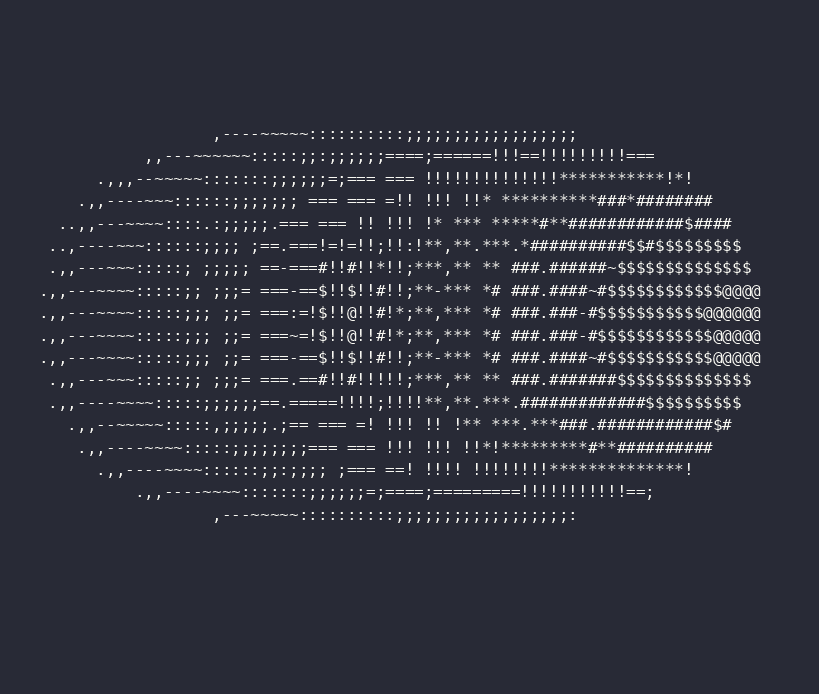

# Haskell Donut

A Haskell implementation of the famous 3D rotating donut (torus) algorithm originally written in C by Andy Sloane, rendered directly in the terminal using ASCII characters.



## About This Project

This project reproduces the famous rotating 3D donut algorithm, demonstrating how a three-dimensional torus can be mathematically represented, rotated, projected onto a two-dimensional screen, and rendered using ASCII characters.

Haskell was chosen because of its functional programming paradigm and its relevance to theoretical computer science. More specifically, its mathematical foundations make it an interesting language for expressing and exploring concepts such as vectors, matrices, geometric transformations, and mathematical functions.

The implementation uses linear algebra to represent and rotate points and surface normals, perspective projection to map three-dimensional coordinates onto the terminal, and a Z-buffer to determine which surface points are visible. Lighting calculations determine which ASCII characters are used to represent the surface.

## Mathematical Concepts

The implementation explores the following concepts:

- **Vectors in \(\mathbb{R}^3\):** Representing three-dimensional positions and surface normals.
- **Matrices:** Representing rotations around the X and Z axes.
- **Dot product:** Used in vector operations and lighting calculations.
- **Rotation matrices:** Applying geometric transformations to the torus.
- **Perspective projection:** Mapping three-dimensional points onto a two-dimensional terminal screen.
- **Surface lighting:** Using the dot product between surface normals and a light direction to calculate luminance.
- **Z-buffering:** Resolving visibility by keeping the nearest surface fragment at each screen position.

## Requirements

- GHC (Glasgow Haskell Compiler)
- A terminal that supports ANSI escape sequences

## Compilation and Execution

Run the following command from the project's root directory:

```bash
ghc -O2 -outputdir builds -o builds/donut src/donut.hs && ./builds/donut
```

The command compiles the source file with optimizations, places generated compilation files in the `builds` directory, creates the executable at `builds/donut`, and runs it.

## License and Attribution

This Haskell implementation is licensed under the [MIT License](LICENSE).

The original C implementation by Andy Sloane is available in [this article](https://www.a1k0n.net/2011/07/20/donut-math.html).

This project is an independent Haskell implementation inspired by the original algorithm. The MIT License applies to this Haskell implementation and does not imply that the original work is distributed under the same license.
